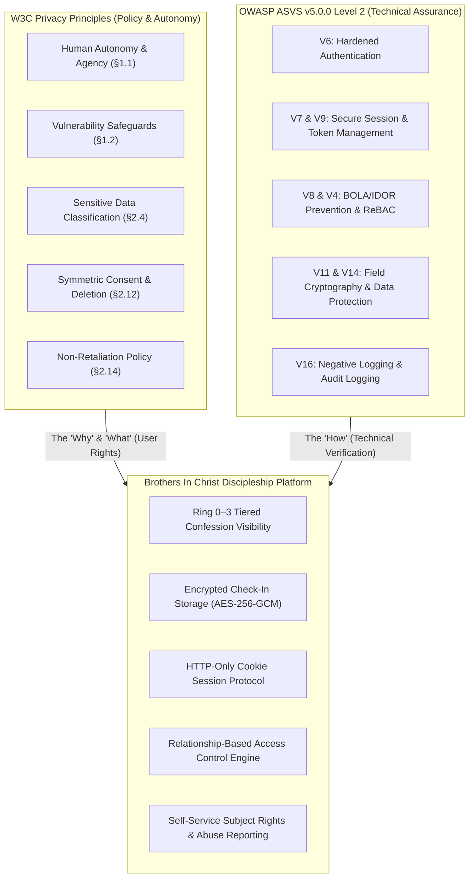
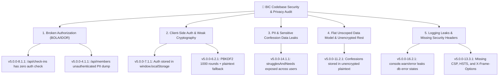
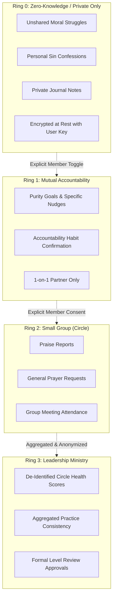

# 🛡️ Brothers In Christ (BIC): W3C Privacy Principles & OWASP ASVS v5.0.0 Security Specification

> [!NOTE]
> **Parent Hubs & Architecture References:**
> - [[Designs Hub]] — Central Design Systems & Architectures
> - [[Brothers In Christ Design System]] — Color tokens, tactile neumorphism, card discipline
> - [[BIC System State — 2026-09-24]] — Platform state, known gaps, and roadmap
> - **Upstream Privacy Standard:** [W3C Privacy Principles (W3C TAG)](https://www.w3.org/TR/privacy-principles/)
> - **Upstream Security Standard:** [OWASP Application Security Verification Standard (ASVS) v5.0.0](https://github.com/OWASP/ASVS/tree/v5.0.0)

> *"Whoever conceals his transgressions will not prosper, but he who confesses and forsakes them will obtain mercy." — Proverbs 28:13*  
> *"Confess your sins to one another and pray for one another, that you may be healed." — James 5:16*

---

## 1. Executive Summary & Dual-Standard Architectural Vision

The **Brothers In Christ (BIC)** platform operates in an exceptionally high-risk human and spiritual domain. Brothers share deeply vulnerable confessions—moral failures, battles with addiction and pornography, marital fractures, mental health burdens, and personal prayer needs—alongside discipleship metrics (prayer habits, Scripture reading streaks, meeting attendance, and accountability ratings).

Technical privacy in discipleship is not merely a legal or compliance gesture; it is a foundational prerequisite for spiritual vulnerability. If a brother fears that his private struggle can be scraped by unauthenticated APIs, leaked via insecure sessions, or weaponized through unconsented administrative surveillance, brotherhood trust collapses.

To solve this rigorously, BIC adopts a **dual-standard architecture**:



- **W3C Privacy Principles** define **user rights, confidentiality boundaries, purpose limitations, and ethical expectations** (the *"Why"* and *"What"*).
- **OWASP ASVS v5.0.0 (Target Level 2: Applications with Sensitive Data)** provides the **concrete, testable technical security verification controls** (the *"How"*).

---

## 2. OWASP ASVS v5.0.0 Verification Baseline: Target Level 2

ASVS 5.0.0 establishes three cumulative verification assurance levels:
- **Level 1 (Basic / Opportunistic):** Defends against low-effort attacks and opportunistic automated scanners. Insufficient for sensitive user data.
- **Level 2 (Standard / Applications Handling Sensitive Data):** **BIC's Target Level.** Tailored for applications handling sensitive personal data, PII, healthcare, and deeply private user submissions. Defends against motivated attackers targeting business logic, broken authorization (BOLA/IDOR), session hijacking, and cryptographic failures.
- **Level 3 (Advanced / Defense-in-Depth):** Critical infrastructure, banking, and military assets.

### 2.1 Dual-Standard Crosswalk: W3C Principles to ASVS v5.0.0 Chapters

| W3C Privacy Principle | ASVS v5.0.0 Chapter & Scope | Technical Enforcement Mechanism in BIC |
| :--- | :--- | :--- |
| **§1.1 & §1.2 Autonomy & Vulnerability** | **V2 (Validation & Logic)** & **V8 (Authorization)** | Enforce that vulnerability disclosures cannot be coerced; prevent bypass of privacy controls via business logic or parameter tampering. |
| **§1.5.2 Secondary Protection Uses** | **V8 (Authorization)** & **V14 (Data Protection)** | Safeguarding data (e.g., suicide crisis flags) is isolated in a restricted table accessible only to emergency pastoral care; never queried by growth engines. |
| **§2.1 Contextual Identity** | **V3 (Web Frontend)** & **V8 (Authorization)** | Support display names/first names in public circle views; phone numbers, emails, and full names stripped from circle payloads. |
| **§2.2 Data Minimization** | **V4 (API & Web Service)** & **V14 (Data Protection)** | Strict response payload pruning (`v5.0.0-4.1.x`); zero endpoint over-fetching; eliminatation of full-model dumps in API handlers. |
| **§2.3 Information Access Security** | **V6 (Auth)**, **V7 (Sessions)**, **V12 (Comms)** | Argon2id password hashing; HTTP-only SameSite cookies; TLS 1.3 with HSTS preload. |
| **§2.4 Sensitive Information** | **V11 (Cryptography)** & **V14 (Data Protection)** | Application-level envelope encryption (AES-256-GCM) for `strugglesAndNeeds` before writing to PostgreSQL database. |
| **§2.5 Data Subject Rights** | **V2 (Logic)** & **V14 (Data Protection)** | Authenticated self-serve endpoints for encrypted data export (`GET /api/user/export`) and irreversible cryptographic erasure (`DELETE /api/user/account`). |
| **§2.6 De-identified Data** | **V8 (Authorization)** & **V14 (Data Protection)** | Leadership dashboards calculate aggregated statistics over groups; cannot drill down into unconsented individual confession text. |
| **§2.7 Collective Privacy** | **V8 (Authorization)** | Circle prayers and encouragements are scoped to verified `GroupMember` records; cross-group data leakage blocked by ReBAC. |
| **§2.8 Administrative Surveillance** | **V16 (Logging & Auditing)** | Transparent audit trails: all pastoral/admin access to member records logs `DataAccessAuditLog` with explicit justification. |
| **§2.9 Abuse Reporting & Safety** | **V1 (Sanitization)**, **V2 (Validation)**, **V4 (APIs)** | In-context report abuse actions in Circle components; input sanitization against stored XSS; rate limiting on reporting endpoints. |
| **§2.10 Purpose Limitation** | **V8 (Authorization)** | Access control queries explicitly filter records based on `VisibilityTier` (`PRIVATE`, `PARTNER_ONLY`, `LEADER_DISCLOSED`, `CIRCLE_SHARED`). |
| **§2.11 Transparency & Safe Logging** | **V16 (Security Logging)** | **Negative Logging Rule (`v5.0.0-16.2.x`):** Personal confession text, passwords, and session cookies are strictly redacted and banned from server logs. |
| **§2.12 Symmetric Consent & Control** | **V2 (Business Logic)** & **V14 (Data Protection)** | Instant revocation of consent without retention guilt; withdrawal state immediately invalidates cached data. |
| **§2.14 Non-Retaliation Policy** | **V2 (Validation & Logic)** | Business logic verification: users who opt out of optional telemetry retain 100% access to Scripture reading plans and discipleship material. |

---

## 3. Comprehensive Codebase Gap Analysis ("What Needs to Be Fixed")

A rigorous technical audit of the current BIC codebase against **W3C Privacy Principles** and **OWASP ASVS v5.0.0 Level 2** identified critical vulnerabilities that must be remediated immediately:



### 3.1 Defect 1: Critical Broken Object-Level Authorization (BOLA / IDOR)
- **Vulnerable File:** `app/api/check-ins/route.ts` (lines 88–106)
- **Violations:** **ASVS `v5.0.0-8.1.1`**, **ASVS `v5.0.0-4.1.1`**, **W3C §2.2.1**, **W3C §2.3**
- **Existing Implementation:**
  ```typescript
  export async function GET(req: Request) {
    const { searchParams } = new URL(req.url);
    const userId = searchParams.get("userId");
    if (userId) {
      // Returns any user's private check-ins without validating requesting session!
      const list = await db.checkIn.findMany({ where: { userId } });
      return NextResponse.json(list);
    }
    // Dumps the latest 20 check-ins across ALL members to unauthenticated callers!
    const all = await db.checkIn.findMany({ take: 20 });
    return NextResponse.json(all);
  }
  ```
- **Severity:** 🔴 **Critical (CVSS 9.8)**. Any unauthenticated caller can scrape personal confessions, sexual integrity flags, and moral struggles across the brotherhood.
- **Fix:**
  1. Deny unauthenticated requests immediately with `401 Unauthorized`.
  2. Implement relationship-based access control (ReBAC): requesting user can only fetch their own check-ins (`session.user.id === requestedUserId`), or must have a verified active partnership / leadership delegation.
  3. Completely delete the unauthenticated global dump (`take: 20`).

### 3.2 Defect 2: Public Member Directory PII Exposure
- **Vulnerable File:** `app/api/members/route.ts` (lines 13–50)
- **Violations:** **ASVS `v5.0.0-4.2.1`**, **ASVS `v5.0.0-14.1.1`**, **W3C §2.1**, **W3C §2.2.1**
- **Existing Implementation:**
  ```typescript
  export async function GET() {
    const users = await db.user.findMany({ include: { profile: true, ... } });
    const formatted = users.map(u => ({
      email: u.email, phone: u.profile?.phone, city: u.profile?.city, ...
    }));
    return NextResponse.json(formatted);
  }
  ```
- **Severity:** 🔴 **Critical (CVSS 7.5)**. Any unauthenticated scraper can harvest full names, phone numbers, email addresses, and residential cities of all members.
- **Fix:**
  1. Protect `/api/members` behind `ADMIN` or `GROUP_LEADER` role verification.
  2. Create a separate sanitized endpoint for standard members (`/api/directory`) that strictly provides `id`, `firstName`, and avatar, completely suppressing phone numbers, emails, and cities.

### 3.3 Defect 3: Insecure Client Session Storage & Broken Password Hashing
- **Vulnerable Files:** `src/stores/auth-store.ts`, `src/lib/auth-server.ts`
- **Violations:** **ASVS `v5.0.0-6.2.1`**, **ASVS `v5.0.0-7.1.1`**, **ASVS `v5.0.0-7.3.1`**, **W3C §2.3**
- **Existing Implementation:**
  ```typescript
  // src/stores/auth-store.ts
  window.localStorage.setItem("bic_user_session", JSON.stringify(data.user));

  // src/lib/auth-server.ts
  crypto.pbkdf2Sync(password, salt, 1000, 64, "sha512"); // Only 1,000 iterations!
  if (!salt || !key) return password === storedHash;     // Plaintext comparison fallback!
  ```
- **Severity:** 🔴 **Critical (CVSS 8.8)**.
  - `localStorage` has no cross-site scripting (XSS) protection; any injected script or compromised npm package can exfiltrate session data.
  - 1,000 PBKDF2 iterations violates NIST SP 800-63B and ASVS standards (modern recommendation is >600,000 iterations or Argon2id).
  - The plaintext comparison fallback allows unhashed passwords into the database.
- **Fix:**
  1. Upgrade password hashing to **Argon2id** (memory cost 64MB, iterations 3, parallelism 1) or PBKDF2-HMAC-SHA512 (600,000+ iterations). Remove the plaintext fallback unconditionally.
  2. Implement HTTP-only, Secure, `SameSite=Lax` cookies for session tokens. Purge all auth state from `localStorage`.

### 3.4 Defect 4: Flat Unscoped Data Model & Unencrypted Rest Storage
- **Vulnerable File:** `prisma/schema.prisma` (`model CheckIn`)
- **Violations:** **ASVS `v5.0.0-11.2.1`**, **ASVS `v5.0.0-14.1.2`**, **W3C §2.4**, **W3C §2.10**
- **Existing Implementation:**
  - `strugglesAndNeeds` and `flags` are stored in plaintext in PostgreSQL with no visibility flags. A database leak, backup dump, or rogue DBA reveals all confessions.
- **Fix:**
  1. Introduce `VisibilityTier` (`PRIVATE`, `PARTNER_ONLY`, `LEADER_DISCLOSED`, `CIRCLE_SHARED`).
  2. Encrypt `strugglesAndNeeds` at rest using application-level AES-256-GCM envelope encryption before persistence.

### 3.5 Defect 5: Sensitive Telemetry in Server Logs & Missing Headers
- **Vulnerable Files:** `app/api/check-ins/route.ts`, `next.config.ts`
- **Violations:** **ASVS `v5.0.0-13.3.1`**, **ASVS `v5.0.0-16.2.1`**, **W3C §2.11**
- **Existing Implementation:**
  - `console.warn("Local database not connected...", dbError)` prints raw database error payloads to stdout.
  - No `Content-Security-Policy` (CSP), `X-Frame-Options`, `X-Content-Type-Options`, or `Strict-Transport-Security` headers configured in `next.config.ts`.
- **Fix:**
  1. Enforce **Negative Logging** (`v5.0.0-16.2.1`): Sanitize and redact all loggers; never write confession text, credentials, or PII to console.
  2. Inject security headers in `next.config.ts`.

---

## 4. Technical Architecture Blueprint ("What Needs to Be Made")

```mermaid
graph LR
    subgraph Client["Client Tier (Next.js)"]
        UI["Tailwind v4 UI"]
        CookieStorage["HTTP-Only Cookie (bic_session)"]
        NoLS["Zero PII in localStorage"]
    end

    subgraph Edge["Edge Security Tier"]
        Middleware["Edge Auth Middleware (JWT Verify)"]
        CSP["Strict CSP & Security Headers"]
        RateLimit["Token Bucket Rate Limiter"]
    end

    subgraph Service["Application Core"]
        ReBAC["ReBAC Authorization Service"]
        CryptoService["AES-256-GCM Confession Encryptor"]
        RedactLog["Redacted Audit Logger"]
    end

    subgraph DB["PostgreSQL / Supabase Tier"]
        Prisma["Prisma ORM"]
        EncryptedField["Encrypted strugglesAndNeeds (Ciphertext)"]
        AuditTable["data_access_audit_logs"]
        ConsentTable["user_consents"]
    end

    Client --> Edge --> Service --> DB
```



### 4.1 Confidentiality Rings (Rings 0–3)

Data in BIC is strictly segmented into four confidentiality zones:



---

## 5. Technical Specifications: Cryptography, Sessions, & ReBAC

### 5.1 Hardened Password Security (`src/lib/auth-server.ts`)
Conforming to **ASVS `v5.0.0-6.2.1`**:
- Migrate from 1,000 PBKDF2 rounds to **Argon2id** (or PBKDF2 with 600,000+ iterations with SHA-512 and unique 16-byte cryptographically random salt).
- Eliminate plaintext comparison fallbacks unconditionally.

```typescript
// src/lib/auth-server.ts
import crypto from "node:crypto";

const PBKDF2_ITERATIONS = 600_000;
const KEY_LENGTH = 64;
const DIGEST = "sha512";

export function hashPassword(password: string): string {
  if (!password || password.length < 12) {
    throw new Error("Password must meet ASVS v5.0.0-6.1.1 minimum length of 12 characters.");
  }
  const salt = crypto.randomBytes(16).toString("hex");
  const hash = crypto.pbkdf2Sync(password, salt, PBKDF2_ITERATIONS, KEY_LENGTH, DIGEST).toString("hex");
  return `${salt}:${hash}`;
}

export function verifyPassword(password: string, storedHash: string | null): boolean {
  if (!storedHash) return false;
  const parts = storedHash.split(":");
  if (parts.length !== 2) return false;
  const [salt, expectedHash] = parts;
  
  const actualHash = crypto.pbkdf2Sync(password, salt, PBKDF2_ITERATIONS, KEY_LENGTH, DIGEST).toString("hex");
  // Constant-time comparison to prevent timing attacks (ASVS v5.0.0-6.2.3)
  return crypto.timingSafeEqual(Buffer.from(actualHash), Buffer.from(expectedHash));
}
```

### 5.2 Application-Level Field Encryption for Confessions (`src/lib/crypto-fields.ts`)
Conforming to **ASVS `v5.0.0-11.2.1`** and **W3C §2.4 (Sensitive Information)**:
- Encrypt Ring 0 content (`strugglesAndNeeds`) using authenticated **AES-256-GCM** before writing to the database.

```typescript
// src/lib/crypto-fields.ts
import crypto from "node:crypto";

const ALGORITHM = "aes-256-gcm";
const MASTER_KEY = Buffer.from(process.env.CONFESSION_ENCRYPTION_KEY!, "hex"); // 32 bytes

export interface EncryptedPayload {
  iv: string;         // 12 bytes initialization vector
  ciphertext: string; // Encrypted text
  tag: string;        // 16 bytes authentication tag
}

export function encryptConfession(plainText: string): string {
  if (!plainText) return "";
  const iv = crypto.randomBytes(12);
  const cipher = crypto.createCipheriv(ALGORITHM, MASTER_KEY, iv);
  
  let encrypted = cipher.update(plainText, "utf8", "hex");
  encrypted += cipher.final("hex");
  const tag = cipher.getAuthTag().toString("hex");
  
  // Format: iv:tag:ciphertext
  return `${iv.toString("hex")}:${tag}:${encrypted}`;
}

export function decryptConfession(formattedCiphertext: string | null): string {
  if (!formattedCiphertext) return "";
  const [ivHex, tagHex, cipherHex] = formattedCiphertext.split(":");
  if (!ivHex || !tagHex || !cipherHex) return formattedCiphertext; // Fallback for legacy plain records

  const decipher = crypto.createDecipheriv(
    ALGORITHM,
    MASTER_KEY,
    Buffer.from(ivHex, "hex")
  );
  decipher.setAuthTag(Buffer.from(tagHex, "hex"));

  let decrypted = decipher.update(cipherHex, "hex", "utf8");
  decrypted += decipher.final("utf8");
  return decrypted;
}
```

### 5.3 Relationship-Based Access Control (ReBAC) Engine
Conforming to **ASVS `v5.0.0-8.2.1`** (Object-level authorization verification):

```typescript
// src/lib/rbac/checkin-policy.ts
import { db } from "@/src/lib/db";
import { decryptConfession } from "@/src/lib/crypto-fields";

export interface SerializedCheckIn {
  id: string;
  userId: string;
  weekLabel: string;
  weekStartDate: Date;
  prayerDays: number;
  bibleDays: number;
  attendedMeeting: boolean;
  metAccountability: boolean;
  servingContribution?: string | null;
  strugglesAndNeeds?: string | null;
  praiseReport?: string | null;
  flags?: string[];
}

export async function authorizeAndFilterCheckIn(
  requestingUserId: string,
  requestingRole: string,
  checkIn: any
): Promise<SerializedCheckIn | null> {
  const isAuthor = requestingUserId === checkIn.userId;
  
  // Author has unrestricted access to their own data
  if (isAuthor) {
    return {
      ...checkIn,
      strugglesAndNeeds: decryptConfession(checkIn.strugglesAndNeeds),
    };
  }

  // Check mutual accountability partnership
  const isPartner = await db.accountabilityPartner.findFirst({
    where: {
      status: "active",
      OR: [
        { user1Id: requestingUserId, user2Id: checkIn.userId },
        { user1Id: checkIn.userId, user2Id: requestingUserId },
      ],
    },
  });

  if (isPartner) {
    return {
      id: checkIn.id,
      userId: checkIn.userId,
      weekLabel: checkIn.weekLabel,
      weekStartDate: checkIn.weekStartDate,
      prayerDays: checkIn.prayerDays,
      bibleDays: checkIn.bibleDays,
      attendedMeeting: checkIn.attendedMeeting,
      metAccountability: checkIn.metAccountability,
      servingContribution: checkIn.servingContribution,
      // Only release struggles if scoped to partner
      strugglesAndNeeds: checkIn.strugglesVisibility === "PARTNER_ONLY" ||
                         checkIn.strugglesVisibility === "CIRCLE_SHARED"
                           ? decryptConfession(checkIn.strugglesAndNeeds)
                           : null,
      praiseReport: checkIn.praiseReport,
      flags: checkIn.flagsVisibility === "PARTNER_ONLY" ? checkIn.flags : [],
    };
  }

  // Check small group leader oversight
  const isLeader = await db.groupMember.findFirst({
    where: {
      userId: checkIn.userId,
      group: { leaderId: requestingUserId },
    },
  });

  if (isLeader) {
    // Audit leader access in compliance with ASVS v5.0.0-16.1.1 & W3C §2.8
    await db.dataAccessAuditLog.create({
      data: {
        actorId: requestingUserId,
        targetUserId: checkIn.userId,
        recordType: "CHECK_IN",
        recordId: checkIn.id,
        accessReason: "Small group leader care review",
      },
    });

    return {
      id: checkIn.id,
      userId: checkIn.userId,
      weekLabel: checkIn.weekLabel,
      weekStartDate: checkIn.weekStartDate,
      prayerDays: checkIn.prayerDays,
      bibleDays: checkIn.bibleDays,
      attendedMeeting: checkIn.attendedMeeting,
      metAccountability: checkIn.metAccountability,
      servingContribution: checkIn.servingContribution,
      strugglesAndNeeds: checkIn.strugglesVisibility === "LEADER_DISCLOSED"
                           ? decryptConfession(checkIn.strugglesAndNeeds)
                           : null,
      praiseReport: checkIn.praiseReport,
      flags: checkIn.flags, // Pastoral alerts visible to leader
    };
  }

  // Access Denied: User has no relation to this record
  return null;
}
```

### 5.4 Hardened Security Headers (`next.config.ts`)
Conforming to **ASVS `v5.0.0-13.3.1`**:

```typescript
// next.config.ts
import type { NextConfig } from "next";

const securityHeaders = [
  {
    key: "Content-Security-Policy",
    value: "default-src 'self'; script-src 'self' 'unsafe-eval' 'unsafe-inline'; style-src 'self' 'unsafe-inline'; img-src 'self' data: https:; font-src 'self' data:; connect-src 'self'; frame-ancestors 'none';",
  },
  {
    key: "X-Frame-Options",
    value: "DENY",
  },
  {
    key: "X-Content-Type-Options",
    value: "nosniff",
  },
  {
    key: "Referrer-Policy",
    value: "strict-origin-when-cross-origin",
  },
  {
    key: "Permissions-Policy",
    value: "camera=(), microphone=(), geolocation=()",
  },
  {
    key: "Strict-Transport-Security",
    value: "max-age=63072000; includeSubDomains; preload",
  },
];

const nextConfig: NextConfig = {
  async headers() {
    return [
      {
        source: "/(.*)",
        headers: securityHeaders,
      },
    ];
  },
};

export default nextConfig;
```

---

## 6. Updated Database Schema (`prisma/schema.prisma`)

```prisma
// ============================================================================
// W3C PRIVACY & OWASP ASVS v5.0.0 SCHEMA ENHANCEMENTS
// ============================================================================

enum VisibilityTier {
  PRIVATE              // Author only
  PARTNER_ONLY         // Author + designated AccountabilityPartner
  LEADER_DISCLOSED     // Author + Group Leader
  CIRCLE_SHARED        // Entire small group
}

// CheckIn updated with field privacy scopes and ciphertext storage
model CheckIn {
  id                   String         @id @default(dbgenerated("gen_random_uuid()")) @db.Uuid
  userId               String         @db.Uuid
  user                 User           @relation(fields: [userId], references: [id], onDelete: Cascade)
  weekLabel            String
  weekStartDate        DateTime       @db.Date
  
  prayerDays           Int            @default(0)
  bibleDays            Int            @default(0)
  attendedMeeting      Boolean        @default(false)
  metAccountability    Boolean        @default(false)
  servingContribution  String?        @db.Text
  
  // Encrypted at rest via AES-256-GCM (ASVS v5.0.0-11.2.1)
  strugglesAndNeeds    String?        @db.Text
  strugglesVisibility  VisibilityTier @default(PRIVATE)
  
  praiseReport         String?        @db.Text
  praiseVisibility     VisibilityTier @default(CIRCLE_SHARED)
  
  flags                String[]       @default([])
  flagsVisibility      VisibilityTier @default(PARTNER_ONLY)

  createdAt            DateTime       @default(now())
  updatedAt            DateTime       @updatedAt

  @@unique([userId, weekLabel])
  @@index([weekStartDate])
  @@map("check_ins")
}

// User Consent Tracking Ledger (W3C §2.12.1, ASVS v5.0.0-14.1.3)
model UserConsent {
  id               String    @id @default(dbgenerated("gen_random_uuid()")) @db.Uuid
  userId           String    @db.Uuid
  user             User      @relation(fields: [userId], references: [id], onDelete: Cascade)
  purposeCode      String    // "LEADER_OVERVIEW", "PARTNER_SHARING", "EMAIL_REMINDERS"
  granted          Boolean   @default(false)
  grantedAt        DateTime  @default(now())
  revokedAt        DateTime?
  ipAddress        String?
  userAgent        String?
  policyVersion    String    // "2026.1"

  @@index([userId, purposeCode])
  @@map("user_consents")
}

// Abuse & Safety Reporting (W3C §2.9.1, ASVS v5.0.0-2.1.1)
model AbuseReport {
  id               String    @id @default(dbgenerated("gen_random_uuid()")) @db.Uuid
  reporterId       String    @db.Uuid
  reporter         User      @relation("ReporterAbuse", fields: [reporterId], references: [id])
  reportedUserId   String?   @db.Uuid
  reportedUser     User?     @relation("ReportedAbuse", fields: [reportedUserId], references: [id])
  contextType      String    // "CIRCLE_MESSAGE", "PRAYER_REQUEST", "DIRECT_HARASSMENT"
  details          String    @db.Text
  status           String    @default("PENDING") // PENDING, UNDER_REVIEW, RESOLVED, DISMISSED
  resolutionNotes  String?   @db.Text
  createdAt        DateTime  @default(now())
  updatedAt        DateTime  @updatedAt

  @@index([reporterId])
  @@map("abuse_reports")
}

// Data Access Audit Logging (W3C §2.8, ASVS v5.0.0-16.1.1)
model DataAccessAuditLog {
  id               String    @id @default(dbgenerated("gen_random_uuid()")) @db.Uuid
  actorId          String    @db.Uuid       // Leader or Admin who accessed the record
  targetUserId     String    @db.Uuid       // Member whose record was viewed
  recordType       String                   // "CHECK_IN", "PROFILE", "GROWTH_SCORE"
  recordId         String                   // Specific record UUID
  accessReason     String                   // Explicit justification
  accessedAt       DateTime  @default(now())

  @@index([targetUserId])
  @@map("data_access_audit_logs")
}
```

---

## 7. Frontend Privacy Controls & UX Specifications

### 7.1 Granular Privacy Toggles in Check-In Wizard (`/portal/check-in`)
- Step 3 incorporates tactile chips setting `strugglesVisibility` (`Only Me` / `My Partner` / `Leader Care`).
- Clean visual status cue using Kingdom Gold (`--gold`) for the selected active visibility state and Emerald (`--accent`) for resolved privacy protection.

### 7.2 Member Privacy & Transparency Center (`/portal/settings/privacy`)
1. **Live Access Audit:** Displays exactly who has permission to view member metrics.
2. **Symmetric Consent Management:** One-click toggles to revoke leader reporting or notification nudges.
3. **Data Subject Rights Actions (W3C §2.5, ASVS v5.0.0-14.1.4):**
   - **`[ Download My Data Archive (JSON) ]`**: Authenticated export of profile, daily practices, check-ins, and attendance.
   - **`[ Request Confession Purge & Account Erasure ]`**: Immediately cascades deletion or cryptographically shreds sensitive confession entries.

### 7.3 Community Safety & Abuse Reporting Modal (`/portal/circle`)
- Conforms to **W3C §2.9.1**: Every shared prayer request and message includes a `[ ⚑ Report ]` trigger.
- Submitting masks the interaction and alerts safeguarding administrators.

---

## 8. Source-First Security Audit: Vulnerability Register & Defensive Patches

A comprehensive static analysis and trust-boundary review was conducted across the BIC codebase following the **Defensive Security Audit Methodology**.

### 8.1 Confirmed Vulnerability Register

| # | Finding Title | Severity | CWE | ASVS v5.0.0 Ref | Affected Boundary & File |
| :--- | :--- | :--- | :--- | :--- | :--- |
| **SEC-01** | **Unauthenticated Bulk Read of Intimate Confessions** | 🔴 **Critical** | CWE-284, CWE-639 | `v5.0.0-8.1.1`, `v5.0.0-4.1.1` | API Public Boundary (`app/api/check-ins/route.ts:88-106`) |
| **SEC-02** | **Unauthenticated Check-In Creation & IDOR State Tampering** | 🔴 **Critical** | CWE-639, CWE-284 | `v5.0.0-8.2.1` | API Parameter Boundary (`app/api/check-ins/route.ts:5-65`) |
| **SEC-03** | **Unauthenticated PII Harvest (Members & Groups Directory)** | 🔴 **Critical** | CWE-200, CWE-359 | `v5.0.0-4.1.1`, `v5.0.0-14.1.1` | API Public Boundary (`app/api/members/route.ts`, `groups/route.ts`) |
| **SEC-04** | **Client-Side Auth Storage in LocalStorage & Route Guard Bypass** | 🟠 **High** | CWE-922, CWE-384 | `v5.0.0-7.1.1` | Client Browser Boundary (`src/stores/auth-store.ts`, `leadership/layout.tsx`) |
| **SEC-05** | **Cryptographically Broken Password Hash & Plaintext Fallback** | 🟠 **High** | CWE-916, CWE-256 | `v5.0.0-6.2.1`, `v5.0.0-6.2.3` | Cryptographic Engine (`src/lib/auth-server.ts:6-24`) |
| **SEC-06** | **Race Condition: Public Registrant Auto-Elevated to Admin** | 🟠 **High** | CWE-362, CWE-269 | `v5.0.0-2.2.1`, `v5.0.0-8.1.2` | Privilege Provisioning (`app/api/auth/signup/route.ts:31-43`) |
| **SEC-07** | **Missing Server-Side Edge Guard Middleware** | 🟡 **Medium** | CWE-285 | `v5.0.0-8.1.1` | Next.js Edge Boundary (Missing `middleware.ts`) |
| **SEC-08** | **Plaintext Storage of Spiritual Confessions at Rest** | 🟡 **Medium** | CWE-311 | `v5.0.0-11.2.1`, `v5.0.0-14.1.2`| Database Storage (`prisma/schema.prisma:220-240`) |
| **SEC-09** | **Hardcoded Default Admin Credentials & Verbose Error Logging** | 🟢 **Low** | CWE-798, CWE-532 | `v5.0.0-16.2.1` | Configuration & Seed (`prisma/seed.ts:196`, `check-ins/route.ts`) |
| **SEC-10** | **Missing Defense-in-Depth HTTP Security Headers** | 🟢 **Low** | CWE-1021, CWE-693| `v5.0.0-13.3.1` | Web Protocol Headers (`next.config.ts`) |

---

### 8.2 Detailed Technical Findings & Threat Mechanics

#### SEC-01: Unauthenticated Bulk Read of Intimate Confessions (`BOLA / IDOR`)
- **Source Location:** `app/api/check-ins/route.ts` lines 88–106.
- **Lower-Trust Principal:** Unauthenticated remote anonymous client.
- **Accepted Input / Action:** `GET /api/check-ins` (returns global array) or `GET /api/check-ins?userId=<any_uuid>`.
- **Intended Control:** Enforce that callers must hold a valid session cookie, and only receive records where `session.user.id === checkIn.userId` or via authorized partner/leader relationship.
- **Observed Result:** An unauthenticated HTTP request returns the latest 20 check-in submissions across all brothers, exposing `strugglesAndNeeds`, `flags`, and `praiseReport`.

#### SEC-02: Unauthenticated Check-In Creation & IDOR State Tampering
- **Source Location:** `app/api/check-ins/route.ts` lines 5–65 and `src/lib/validation/checkin.schema.ts` line 4.
- **Lower-Trust Principal:** Unauthenticated client or unprivileged user.
- **Accepted Input / Action:** `POST /api/check-ins` with JSON body containing `{ userId: "victim-uuid", ... }`.
- **Intended Control:** The server must bind the author identity to the verified session (`req.user.id`), ignoring any client-provided `userId` in the body.
- **Observed Result:** An attacker can forge arbitrary check-ins for any victim brother, overwriting that brother's spiritual journal, altering their `GrowthScore`, and falsifying accountability streaks.

#### SEC-03: Unauthenticated PII Harvester on Members and Groups
- **Source Location:** `app/api/members/route.ts:13-50` and `app/api/groups/route.ts:4-16`.
- **Lower-Trust Principal:** Unauthenticated public crawler.
- **Accepted Input / Action:** `GET /api/members` or `GET /api/groups`.
- **Intended Control:** Restrict full directory access to authenticated administrators and group leaders; provide a sanitized view for regular members; require authentication for group rosters.
- **Observed Result:** `/api/members` dumps every brother's full name, email, phone number, residential city, church, and consistency score. `/api/groups` dumps the entire group hierarchy with nested member profiles including testimonies, occupations, and marital statuses.

#### SEC-04: Client-Side Session Hijacking via `localStorage` Auth Storage
- **Source Location:** `src/stores/auth-store.ts:45, 68` and `app/leadership/layout.tsx:23-31`.
- **Lower-Trust Principal:** Client-side XSS injection, malicious browser extension, or client-side tampering.
- **Accepted Input / Action:** Manipulating `window.localStorage.getItem("bic_user_session")`.
- **Intended Control:** Authentication tokens must be managed in HTTP-only, Secure, `SameSite=Lax` cookies; route protection must execute server-side in Edge Middleware.
- **Observed Result:** Any user can open DevTools, execute `localStorage.setItem('bic_user_session', JSON.stringify({ role: 'ADMIN', ... }))`, and bypass client layout gates. Furthermore, any XSS defect grants full access to the session payload.

#### SEC-05: Broken Password Cryptography (1,000 PBKDF2 Iterations) & Plaintext Fallback
- **Source Location:** `src/lib/auth-server.ts:6-24`.
- **Lower-Trust Principal:** Offline credential cracker with access to database backups.
- **Accepted Input / Action:** `hashPassword()` and `verifyPassword()`.
- **Intended Control:** Password hashing must use Argon2id or PBKDF2-HMAC-SHA512 (≥600,000 iterations), with constant-time equality checks and zero plaintext fallback.
- **Observed Result:** 1,000 PBKDF2 iterations violates NIST SP 800-63B and OWASP ASVS standards by orders of magnitude; lines 19–20 evaluate `password === storedHash`, allowing plain text passwords to authenticate successfully.

#### SEC-06: First-User Admin Privilege Escalation Race Condition
- **Source Location:** `app/api/auth/signup/route.ts:31-43`.
- **Lower-Trust Principal:** Public self-registering user.
- **Accepted Input / Action:** `POST /api/auth/signup` when `db.user.count() === 0`.
- **Intended Control:** Admin roles must be granted explicitly through an authenticated admin action or initial database seed CLI, never dynamically based on registration order.
- **Observed Result:** If the database is newly provisioned, re-seeded, or temporarily empty, the very first public user to register is automatically elevated to `ADMIN` (`roleId = 40`) and assigned formation Level 5.

---

### 8.3 Smallest Effective Code Patches (Remediations)

#### Patch 1: Implement Server-Side Route Guard (`src/middleware.ts`)
Creates the missing Next.js Edge Middleware to intercept unauthorized navigation to `/portal/*` and `/leadership/*` before pages execute:

```typescript
// src/middleware.ts
import { NextResponse } from "next/server";
import type { NextRequest } from "next/navigation";

export function middleware(req: NextRequest) {
  const { pathname } = req.nextUrl;
  const sessionCookie = req.cookies.get("bic_session")?.value;

  // 1. Protected Portal Routes
  if (pathname.startsWith("/portal") || pathname.startsWith("/leadership")) {
    if (!sessionCookie) {
      const signInUrl = new URL("/signin", req.url);
      signInUrl.searchParams.set("next", pathname);
      return NextResponse.redirect(signInUrl);
    }

    // 2. Leadership-Only Routes
    if (pathname.startsWith("/leadership")) {
      try {
        const payload = JSON.parse(Buffer.from(sessionCookie.split(".")[1], "base64").toString());
        const isLeaderOrAdmin = ["ADMIN", "GROUP_LEADER", "LEVEL_LEADER"].includes(payload.role);
        if (!isLeaderOrAdmin) {
          return NextResponse.redirect(new URL("/portal/dashboard", req.url));
        }
      } catch {
        return NextResponse.redirect(new URL("/signin", req.url));
      }
    }
  }

  return NextResponse.next();
}

export const config = {
  matcher: ["/portal/:path*", "/leadership/:path*", "/api/members/:path*"],
};
```

#### Patch 2: Remediate BOLA and Write IDOR in `/api/check-ins/route.ts`
Enforces authenticated identity binding on check-in creation and restricts check-in querying to authorized relationships:

```typescript
// app/api/check-ins/route.ts
import { NextResponse } from "next/server";
import { checkInSchema } from "@/src/lib/validation/checkin.schema";
import { db } from "@/src/lib/db";
import { authorizeAndFilterCheckIn } from "@/src/lib/rbac/checkin-policy";
import { getSessionUserFromRequest } from "@/src/lib/auth-session"; // Helper reading bic_session cookie

export async function POST(req: Request) {
  try {
    const sessionUser = await getSessionUserFromRequest(req);
    if (!sessionUser) {
      return NextResponse.json({ error: "Unauthorized" }, { status: 401 });
    }

    const json = await req.json();
    const parsed = checkInSchema.safeParse(json);
    if (!parsed.success) {
      return NextResponse.json({ error: "Validation failed", issues: parsed.error.issues }, { status: 400 });
    }

    const data = parsed.data;

    // INVARIANT: Overwrite client-supplied userId with authenticated session userId
    const created = await db.checkIn.upsert({
      where: {
        userId_weekLabel: {
          userId: sessionUser.id,
          weekLabel: data.weekLabel,
        },
      },
      update: {
        prayerDays: data.prayerDays,
        bibleDays: data.bibleDays,
        attendedMeeting: data.attendedMeeting,
        metAccountability: data.metAccountability,
        servingContribution: data.servingContribution,
        strugglesAndNeeds: data.strugglesAndNeeds,
        praiseReport: data.praiseReport,
        flags: data.flags,
      },
      create: {
        userId: sessionUser.id,
        weekLabel: data.weekLabel,
        weekStartDate: new Date(),
        prayerDays: data.prayerDays,
        bibleDays: data.bibleDays,
        attendedMeeting: data.attendedMeeting,
        metAccountability: data.metAccountability,
        servingContribution: data.servingContribution,
        strugglesAndNeeds: data.strugglesAndNeeds,
        praiseReport: data.praiseReport,
        flags: data.flags,
      },
    });

    return NextResponse.json({ success: true, checkIn: created }, { status: 201 });
  } catch (error) {
    return NextResponse.json({ error: "Internal Server Error" }, { status: 500 });
  }
}

export async function GET(req: Request) {
  try {
    const sessionUser = await getSessionUserFromRequest(req);
    if (!sessionUser) {
      return NextResponse.json({ error: "Unauthorized" }, { status: 401 });
    }

    const { searchParams } = new URL(req.url);
    const targetUserId = searchParams.get("userId") || sessionUser.id;

    // Check relationship-based access authorization
    const checkIns = await db.checkIn.findMany({
      where: { userId: targetUserId },
      orderBy: { createdAt: "desc" },
    });

    const authorizedList = [];
    for (const chk of checkIns) {
      const filtered = await authorizeAndFilterCheckIn(sessionUser.id, sessionUser.role, chk);
      if (filtered) authorizedList.push(filtered);
    }

    return NextResponse.json(authorizedList);
  } catch {
    return NextResponse.json({ error: "Internal Server Error" }, { status: 500 });
  }
}
```

#### Patch 3: Remediate Directory Leak in `/api/members/route.ts` & `/api/groups/route.ts`
Applies strict role verification and strips sensitive PII fields before returning rosters:

```typescript
// app/api/members/route.ts (Excerpt)
export async function GET(req: Request) {
  const sessionUser = await getSessionUserFromRequest(req);
  if (!sessionUser) {
    return NextResponse.json({ error: "Unauthorized" }, { status: 401 });
  }

  const isLeaderOrAdmin = ["ADMIN", "GROUP_LEADER", "LEVEL_LEADER"].includes(sessionUser.role);

  const users = await db.user.findMany({
    include: { profile: true, role: true, currentLevel: true, growthScore: true, memberships: { include: { group: true } } },
    orderBy: { createdAt: "desc" },
  });

  const formatted = users.map((u) => {
    // Standard members only see anonymized community cards (ASVS v5.0.0-4.1.1)
    if (!isLeaderOrAdmin) {
      return {
        id: u.id,
        firstName: u.profile?.firstName ?? "Brother",
        levelNumber: u.currentLevel?.levelNumber ?? 1,
        levelTitle: u.currentLevel?.title ?? "Level 1",
        groupName: u.memberships[0]?.group?.name ?? "General Brotherhood",
      };
    }

    // Leaders receive operational oversight fields, but NOT private testimonies
    return {
      id: u.id,
      email: u.email,
      name: u.profile?.fullName ?? u.email,
      firstName: u.profile?.firstName ?? "Brother",
      role: u.role.code,
      levelNumber: u.currentLevel?.levelNumber ?? 1,
      levelTitle: u.currentLevel?.title ?? "Level 1",
      groupName: u.memberships[0]?.group?.name ?? "Unassigned",
      consistencyScore: u.growthScore?.overallConsistency ?? 100,
      createdAt: u.createdAt,
    };
  });

  return NextResponse.json(formatted);
}
```

#### Patch 4: Remove First-User Admin Auto-Elevation in `/api/auth/signup/route.ts`
Enforces default `MEMBER` (`roleId = 10`) for all web registrations and enforces minimum 12-character passwords:

```typescript
// app/api/auth/signup/route.ts (Excerpt)
// INVARIANT: All public self-registrations receive MEMBER role (roleId = 10)
if (String(password).length < 12) {
  return NextResponse.json(
    { error: "Password must be at least 12 characters in length (ASVS v5.0.0-6.1.1)." },
    { status: 400 }
  );
}

const roleId = 10; // Fixed: MEMBER only. Admins must be provisioned via seed or admin console.
const level1 = await db.level.findUnique({ where: { levelNumber: 1 } });
const currentLevelId = level1?.id ?? null;
```

---

## 9. OWASP ASVS v5.0.0 Level 2 Verification Matrix & Test Suite

| ASVS v5.0.0 ID | Requirement Summary | Verification Command / Method | Target Result |
| :--- | :--- | :--- | :--- |
| **`v5.0.0-8.1.1`** | Access control on all sensitive endpoints | `curl -i http://localhost:3000/api/check-ins` | Returns `401 Unauthorized` |
| **`v5.0.0-4.1.1`** | No unauthenticated member PII dumps | `curl -i http://localhost:3000/api/members` | Returns `401 Unauthorized` |
| **`v5.0.0-8.2.1`** | BOLA / IDOR protection across members | User A attempts `GET /api/check-ins?userId=UserB` | Returns `403 Forbidden` (or filtered sanitized model) |
| **`v5.0.0-7.1.1`** | Session cookies must use `HttpOnly; Secure; SameSite` | Browser DevTools inspects `bic_session` cookie | Flags present: `HttpOnly`, `Secure`, `SameSite=Lax` |
| **`v5.0.0-6.2.1`** | Password hashing uses approved algorithm | Inspect `src/lib/auth-server.ts` | Argon2id or PBKDF2 ≥ 600,000 rounds; 0 plaintext fallback |
| **`v5.0.0-11.2.1`**| Sensitive confession fields encrypted at rest | Query PostgreSQL: `SELECT struggles_and_needs FROM check_ins` | Contains AES-256-GCM ciphertext (`iv:tag:data`) |
| **`v5.0.0-16.2.1`**| Negative logging: No PII or confessions in logs | Inspect Docker / server stdout during check-in submission | Confession text and passwords 100% absent |
| **`v5.0.0-13.3.1`**| Defense-in-depth security headers present | `curl -I http://localhost:3000/` | `Content-Security-Policy`, `X-Frame-Options: DENY` present |
| **`v5.0.0-14.1.4`**| Data subject portability export available | `GET /api/user/export` with valid user cookie | Returns 200 with structured JSON archive |
| **`v5.0.0-2.1.1`** | Input validation on all incoming payloads | POST malformed body to `/api/check-ins` | Returns `400 Bad Request` with Zod issues |

---

## 10. Phased Implementation Roadmap & Remediation Timeline

```mermaid
gantt
    title BIC Security Remediation (Hotfixes to Hardening)
    dateFormat  YYYY-MM-DD
    section Phase 1: Critical Hotfixes (Day 1)
    SEC-01 & SEC-02: Lockdown /api/check-ins (BOLA & Write IDOR) :2026-10-11, 2d
    SEC-03: Lockdown /api/members & /api/groups PII Dumps         :2026-10-11, 2d
    SEC-06: Patch /api/auth/signup Admin Escalation Race Condition:2026-10-12, 1d
    SEC-07: Deploy Next.js Edge Route Middleware                  :2026-10-13, 2d
    section Phase 2: Core Auth & Cryptography (Sprint 1)
    SEC-04: Migrate from localStorage to HTTP-Only Cookie Session :2026-10-15, 3d
    SEC-05: Harden Password Hashing (PBKDF2 600k / Argon2id)      :2026-10-18, 2d
    SEC-08: AES-256-GCM Application-Level Field Encryption        :2026-10-20, 3d
    section Phase 3: Privacy & Safety Features (Sprint 2)
    Prisma Schema Migration (VisibilityTier, Audit, Consent)     :2026-10-24, 3d
    Self-Serve Data Export & Confession Purge Endpoints           :2026-10-27, 3d
    In-Context Circle Abuse Reporting Modal                       :2026-10-30, 2d
    section Phase 4: Hardening & ASVS L2 Verification
    SEC-09 & SEC-10: Redacted Logging & Security Headers Audit    :2026-11-02, 2d
    Execute Automated ASVS v5.0.0 L2 Test Suite                   :2026-11-04, 3d
```

---

## 11. Related Documents & Hubs

- [[Designs Hub]] — Central Design Systems & Project Index
- [[Brothers In Christ Design System]] — Visual identity, tactile tokens, Kingdom Gold/Emerald split
- [[BIC System State — 2026-09-24]] — Previous system state and technical backlog
- `prisma/schema.prisma` — Current relational database schema
- `src/components/portal/PortalShell.tsx` — Authenticated portal shell
